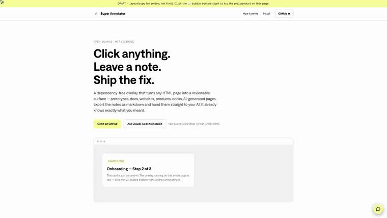

# Super Annotator

**Click anything. Leave a note, alone or live with your team. Export straight into your AI's next prompt.**

A single dependency-free JavaScript file that drops a click-to-annotate overlay
onto any HTML page. Reviewers click an element, type a note, and it appears as
an inline card right next to what it's about — no sidebar, no separate tool.
Export turns every note into markdown, scoped to the exact element it's on, so
you can paste it straight into Claude (or any AI) and it knows exactly what to
change.

Works on anything that renders as HTML: **prototypes, internal tools, decks,
one-pagers, reports, marketing sites, and AI-generated pages.**



**[▶ Watch the 30-second demo](./media/marketing.mp4)** · **[▶ Watch the install + reprompt tutorial](./media/tutorial.mp4)**

## Live, with your team

Turn on multiplayer and everyone on the page comments together: new threads,
replies and resolves land for everyone in a fraction of a second. People add a
name, nothing else. On a phone it switches to pins that open the whole thread.


**[▶ Watch the 90-second live demo](./media/live.mp4)** · **[Try it with a friend](https://annotate-live.supermodular.workers.dev)** (open it on your laptop and your phone)

It is opt-in. Without a sync config the overlay is exactly the single-player
tool below: no network calls, notes in your own browser.

```bash
# inject with live comments through a relay
node inject-annotate.js review.html --sync=wss://your-relay.example.com/sync --room=q4-review

# or run everything locally: relay + a demo page at http://localhost:4620
npm run demo
```

The relay comes in two flavours that share the same room rules: a
zero-dependency Node server (`relay/server.js`) and a Cloudflare Worker with one
Durable Object per room (`relay/cloudflare/`, fits the free plan). We
stress-tested the hosted one with 50 people commenting at once: everyone joined
in under 1.5s and comments reached the room in about 140ms (p50). See
[SKILL.md](./SKILL.md#multiplayer-opt-in-live-comments) for the protocol, limits
and moderation.

## Install

**Ask Claude Code to do it** (recommended — no setup):

> "Install Super Annotator from github.com/supermodularai/super-annotator on
> this project."

Claude reads `SKILL.md` in this repo and inlines `annotator.js` into your
HTML file(s), idempotently — running it again just refreshes the block.

**Or run the CLI directly** (just needs Node.js, no `npm install`):

```bash
git clone https://github.com/supermodularai/super-annotator.git
node super-annotator/inject-annotate.js path/to/your-page.html
```

**Or copy-paste it by hand:** wrap the contents of `annotator.js` in a
`<script>` tag and drop it right before `</body>` in your HTML file.

## Usage

```bash
# Inject into a single file
node inject-annotate.js path/to/page.html

# Inject into every top-level .html file in a folder
node inject-annotate.js path/to/folder/

# Recurse into subfolders too
node inject-annotate.js path/to/folder/ --recursive
```

| Flag | Effect |
|---|---|
| `--key=<string>` | Shared `localStorage` key across a multi-page site, so annotations sync between pages |
| `--name=<string>` | Display name shown in the exported markdown |
| `--reviewer=<string>` | Pre-fills the reviewer name field |
| `--plugin` | Ships the overlay dormant — no bubble, no hint — until a reviewer appends `?=annotate` to the URL |
| `--sync=<ws(s)://…/sync>` | Live multiplayer through a relay |
| `--room=<string>` | Who shares comments (defaults to the file name) |
| `--recursive` | Scan subdirectories, not just the top level |

Re-running the command on an already-annotated file refreshes it in place
(idempotent `<!-- annotate:v1 START/END -->` markers) — safe to run as often
as you want.

## How it works

1. **Click** any element on the page. A composer opens.
2. **Type a note.** Quick-action chips (`Delete this` / `Reword this` /
   `Shorten this`) cover the most common feedback in one click.
3. **Cards stack inline**, next to the element they're about — Notion-style,
   no sidebar to lose track of.
4. **Export.** Copy or download the notes as markdown, grouped by element.
5. **Paste into your AI.** Each note is already scoped to a specific
   element/selector — your AI doesn't have to guess what "this" refers to.

## Why not just leave comments in a doc?

Because the feedback loses its context the moment it leaves the page. "Make
the button bigger" means nothing on its own — Super Annotator keeps the note
attached to *that exact button*, so when you export it and hand it to an AI,
the AI is looking at the same thing you were.

## Requirements

Just Node.js for the CLI (any reasonably recent version; Node 22+ for the relay). The overlay itself
(`annotator.js`) is pure vanilla JS — no dependencies, no build step, works in
any browser.

## Tests

```bash
npm test           # unit tests
npm run test:e2e   # Playwright end-to-end tests: desktop, phone and live sync
```

## Contributing

Contributions are welcome — see [CONTRIBUTING.md](./CONTRIBUTING.md).

## License

Licensed under the [Apache License, Version 2.0](./LICENSE).

Copyright 2026 supermodular.ai GmbH. See [NOTICE](./NOTICE) for attributions.

---

Built by [Supermodular.ai](https://supermodular.ai).
